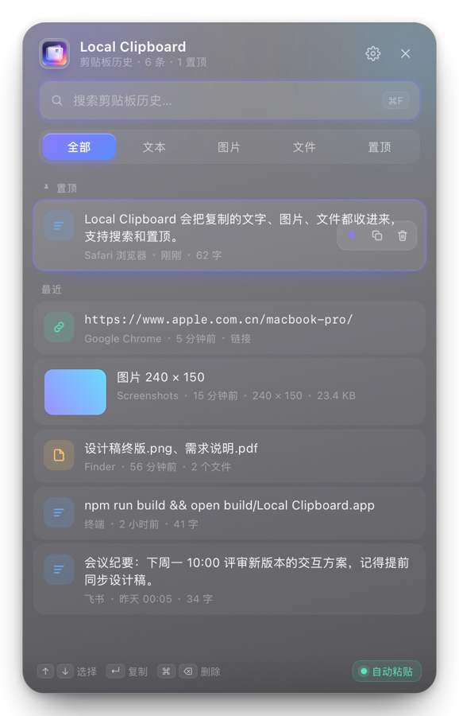

# Local Clipboard

一个原生、轻量、**纯本地**的 macOS 剪贴板历史管理器。自动记录你复制过的文字、链接、图片和文件，按 `⌘⇧V` 随时唤出，搜索、选中、粘贴一气呵成。

没有任何账号、没有云端、不联网、不采集。数据只存在你自己的硬盘上。

<p align="center">
  
</p>

<p align="center">
  
  
  
  
  
</p>

---

## 它解决什么问题

macOS 只有一块剪贴板：复制下一段，上一段就没了。真正需要回找的时候，往往是刚被覆盖掉的那条。

Local Clipboard 常驻菜单栏，默默记下最近复制的内容。要用的那一刻按 `⌘⇧V`，面板从屏幕中央浮出，历史和搜索就在眼前。

**设计取向**：不做云同步、不做团队共享、不做 AI 改写。只把「本机剪贴板历史」这一件事做扎实——快、稳、好看、不打扰。

## 功能

| 能力 | 说明 |
| --- | --- |
| 自动记录 | 文本、链接、图片、文件；重复内容自动去重并提到最前 |
| 全局快捷键 | 默认 `⌘⇧V`，可任意重录；组合被占用时自动回退到可用键 |
| 一键粘贴 | 选中即写回剪贴板，可选「自动粘贴」直接送入当前应用 |
| 图片支持 | 原图落盘 + 缩略图 + 面板内大图预览 |
| 搜索筛选 | 全部 / 文本 / 图片 / 文件 / 置顶，实时本地过滤 |
| 置顶收藏 | 常用片段固定顶部，清空历史时保留 |
| 存储策略 | 保留 100 / 300 / 500 / 1000 条，图片占用上限，按天自动清理 |
| 隐私保护 | 过滤密码管理器等标记为 `ConcealedType` 的内容；纯本地存储 |
| 开机自启 | 写入 `~/Library/LaunchAgents`，随登录静默启动 |
| 暗黑模式 | 跟随系统自动切换，也可手动锁定浅色 / 深色；原生材质与网页主题同步过渡 |
| 自定义存储位置 | 设置中一键更改数据目录，历史与图片自动迁移，可随时恢复默认 |
| 备份与迁移 | 导出为单个 zip（含 `history.json` 与全部图片），导入自动按内容去重合并 |
| 外观 | 真实系统毛玻璃（`NSVisualEffectView`），浅色 / 深色双主题 |

### 键盘流

全程不用碰鼠标：

| 按键 | 动作 |
| --- | --- |
| `⌘⇧V` | 唤出 / 收起面板（可自定义） |
| `↑` `↓` | 上下选择 |
| `↵` / 单击卡片 | 复制（开启自动粘贴时直接粘贴） |
| `⌘1` ~ `⌘9` | 直接复制第 1~9 条 |
| `⌘F` | 聚焦搜索框 |
| `⌘⌫` | 删除选中条目 |
| `⌘,` | 打开设置 |
| `esc` | 逐层退出：缩略图 → 设置 → 搜索词 → 面板 |

## 安装

从 [Releases](../../releases) 下载 `Local Clipboard-1.0.0.dmg`，挂载后任选一种方式：

1. **拖拽**：把 `Local Clipboard.app` 拖进右侧 `Applications`
2. **一键**：双击 `Install Local Clipboard.command`，自动安装到 `/Applications` 并启动

> 首次打开若提示「无法验证开发者」：在「应用程序」中 **右键 → 打开 → 打开**；
> 或执行 `sudo xattr -dr com.apple.quarantine "/Applications/Local Clipboard.app"`。
> 项目使用本地 ad-hoc 签名，未做 Apple 公证，属正常现象。

**自动粘贴**需要「辅助功能」权限：系统设置 → 隐私与安全性 → 辅助功能 → 勾选 Local Clipboard。不授权也能用，只是退化成「仅复制到剪贴板」，手动 `⌘V` 效果相同。

## 技术实现

这个项目有意思的地方在于**它几乎不用 Apple 的标准工程化路径**：

- **零第三方依赖、零 Xcode**：只有一个 `build.sh`，用命令行工具里的 `swiftc` 直接编译 10 个 Swift 文件成可执行文件，再手工组装 `.app` 包、生成 `.icns`、ad-hoc 签名、打包 DMG。整个构建不到 5 秒，`git clone` 完就能改。
- **AppKit + WebKit 混合架构**：窗口、毛玻璃、全局快捷键、剪贴板轮询、状态栏是原生 Swift；面板内部的列表、动画、搜索、键盘导航是 HTML/CSS/JS。界面迭代不需要重新编译 Swift。
- **自绘图标管线**：`scripts/make_icon_from_image.swift` 能把一张 2048px 设计稿自动抠底、按 Apple 图标网格裁切、套 squircle 圆角与投影，一次生成 16→1024 全部 10 个尺寸，并顺带产出面板标题栏用的小图。
- **可靠的原生 ↔ 网页桥**：原生侧维护 `jsReady` 标志 + pending 队列，网页通过 `post("ready")` 主动握手，避免页面未就绪时推送丢数据；每条消息带自增 id 做请求响应匹配。
- **可自测**：`scripts/uitest.swift` 能离屏渲染真实界面、输出 DOM 指标与 JS 错误并截图；`scripts/verify_live.swift` 完整复现桥接门控逻辑验证数据链路。两者都不需要屏幕录制权限，适合放进 CI。

代码规模：Swift 约 1300 行，Web 层约 1550 行（无框架、无构建工具）。

### 目录结构

```
local-clipboard/
├── Sources/                      # 原生层（AppKit + WebKit 桥接）
│   ├── main.swift                # 入口
│   ├── AppDelegate.swift         # 菜单栏、状态栏图标、右键菜单、生命周期
│   ├── PanelController.swift     # 面板窗口、JS 桥、快捷键录制、粘贴调度
│   ├── ClipboardMonitor.swift    # 剪贴板轮询与类型识别
│   ├── HistoryStore.swift        # 持久化、去重、清理策略、图片资源管理
│   ├── PasteService.swift        # 写回剪贴板 + 模拟 ⌘V
│   ├── HotKeyManager.swift       # Carbon 全局快捷键注册与冲突回退
│   ├── SettingsStore.swift       # 设置、开机启动、键名映射
│   ├── ImageUtils.swift          # 缩略图 / 预览图生成
│   └── Models.swift              # 数据模型
├── Web/                          # 界面层（HTML + CSS + JS，无框架）
├── Resources/
│   ├── Info.plist
│   └── AppLogo.png               # 图标源图（替换后重新构建即生效）
├── scripts/
│   ├── make_icon_from_image.swift  # 设计稿 → 全尺寸 icns
│   ├── make_icon.swift             # 纯代码绘制图标的兜底方案
│   ├── uitest.swift                # 离屏渲染 + DOM 断言 + 截图
│   ├── verify_live.swift           # 桥接数据链路验证
│   ├── Install.command             # DMG 内一键安装脚本
│   └── 安装说明.txt
├── docs/screenshot.png
└── build.sh
```

### 从源码构建

```bash
git clone <repo-url> && cd local-clipboard
bash build.sh            # 编译 → 组装 .app → 生成 .icns → 签名 → 打包 DMG
open "build/Local Clipboard.app"
```

只需 **Command Line Tools**（`xcode-select --install`），不需要完整 Xcode。产物在 `build/` 与 `dist/`。

### 数据位置

```
~/Library/Application Support/Local Clipboard/
├── history.json      # 历史索引（含置顶状态、来源应用、时间戳）
└── images/           # 原图 / 缩略图 / 预览图
```

删除这个目录即等于「彻底清空」，不残留任何其他位置的数据。

## 已知限制

- 仅支持 **Apple Silicon**（构建目标 `arm64-apple-macos13.0`）；Intel 需自行把 `build.sh` 里的 `TARGET` 改成 `x86_64-apple-macos13.0`
- 无 iCloud / 多设备同步，这是刻意的取舍
- ad-hoc 签名，未公证，首次打开需手动放行
- 面板失焦会自动收起，这是预期行为

## 路线图

- [x] 暗黑模式（跟随系统 + 手动切换）
- [x] 自定义存储位置（自动迁移数据）
- [x] 导出 / 导入原始数据（zip 备份与合并恢复）
- [ ] 条目内联编辑与「粘贴为纯文本」
- [ ] 快捷键分应用场景（在不同 App 里触发不同动作）
- [ ] 图片 OCR 文本检索（纯本地框架）
- [ ] Homebrew Cask 分发
- [ ] 界面中英双语

## 贡献

Issue 和 PR 都欢迎。改动界面只需动 `Web/`；改完建议跑一次自检：

```bash
swift -sdk "$(xcrun --show-sdk-path)" scripts/uitest.swift Web build/ui-shot.png
```

它会输出卡片数量、分区分组、面板尺寸、标题排版、JS 错误等指标，比手点快。

## 许可

本项目基于 [Apache License 2.0](LICENSE) 发布。

```
Copyright 2026 junyue

Licensed under the Apache License, Version 2.0 (the "License");
you may not use this file except in compliance with the License.
You may obtain a copy of the License at

    http://www.apache.org/licenses/LICENSE-2.0

Unless required by applicable law or agreed to in writing, software
distributed under the License is distributed on an "AS IS" BASIS,
WITHOUT WARRANTIES OR CONDITIONS OF ANY KIND, either express or implied.
See the License for the specific language governing permissions and
limitations under the License.
```

简单说：可自由使用、修改、商用与再分发，需保留版权与许可声明、对修改过的文件作出说明，并附带明确的专利授权与免责条款。
